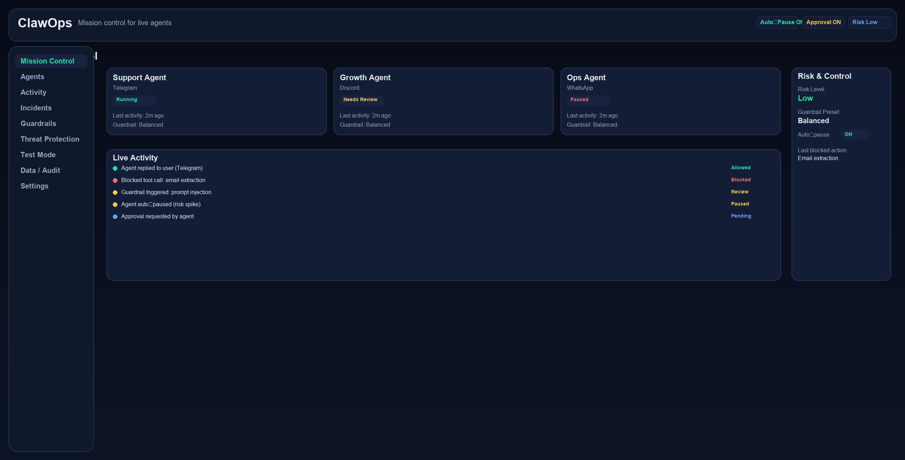

[ClawOps](https://clawops.ai) is the control plane for AI agents running in public channels. It helps non-technical teams keep agents safe, visible, and under control across Telegram, Discord, WhatsApp, and SMS. ClawOps is powered by the open-core ClawOps Engine for security and observability.

- [x] ✅ **Control**
    - [x] Agent status, pause/resume, and kill switch
    - [x] Channel-first onboarding (no CLI, no YAML)
    - [x] Human-readable activity timelines
- [x] 🛡️ **Guardrails**
    - [x] Simple safety toggles mapped to policy rules
    - [x] Blocks (prompt-based rules for direct injection)
    - [x] Auto-pause on repeated risk
- [x] 📊 **Visibility**
    - [x] Activity timelines with technical details on demand
    - [x] Risk scoring and safety trends
    - [x] OpenTelemetry-native traces under the hood

## Demo

<p align="center">
  
</p>

## Quick Start (5 minutes)

Get ClawOps running locally in minutes.

### Prerequisites

- Docker and Docker Compose installed
- Git

### Step 1: Clone and Setup

```bash
git clone https://github.com/clawops/clawops
cd clawops
```

### Step 2: Create Environment File

Create a `.env` file in the project root with minimal required variables:

**Linux/Mac:**
```bash
cat > .env << 'EOF'
# Database (required)
POSTGRES_USER=postgres
POSTGRES_PASSWORD=postgres
POSTGRES_DB=postgres
CLAWOPS_ENGINE_DB_NAME=clawops_engine

# ClickHouse (required)
CLICKHOUSE_USER=default
CLICKHOUSE_PASSWORD=clickhouse_password

# Security tokens (required - generate random strings)
SHARED_SECRET_TOKEN=$(openssl rand -hex 32)
AEAD_SECRET_KEY=$(openssl rand -hex 32)
CLAWOPS_ENGINE_API_KEY=$(openssl rand -hex 16)
NEXTAUTH_SECRET=$(openssl rand -hex 32)
CLAWOPS_ENGINE_URL=http://localhost:8006

# LLM Configuration (optional - for guardrail checks)
OPENAI_API_KEY=your-openai-key-here
OPENAI_BASE_URL=https://openrouter.ai/api/v1
OPENAI_MODEL=gpt-4o-mini
EOF
```

**Windows (PowerShell):**
```powershell
@"
# Database (required)
POSTGRES_USER=postgres
POSTGRES_PASSWORD=postgres
POSTGRES_DB=postgres
CLAWOPS_ENGINE_DB_NAME=clawops_engine

# ClickHouse (required)
CLICKHOUSE_USER=default
CLICKHOUSE_PASSWORD=clickhouse_password

# Security tokens (required - replace with random strings)
SHARED_SECRET_TOKEN=replace-with-random-32-char-string
AEAD_SECRET_KEY=replace-with-random-32-char-string
CLAWOPS_ENGINE_API_KEY=replace-with-random-16-char-string
NEXTAUTH_SECRET=replace-with-random-32-char-string
CLAWOPS_ENGINE_URL=http://localhost:8006

# LLM Configuration (optional - for guardrail checks)
OPENAI_API_KEY=your-openai-key-here
OPENAI_BASE_URL=https://openrouter.ai/api/v1
OPENAI_MODEL=gpt-4o-mini
"@ | Out-File -FilePath .env -Encoding utf8
```

**Or use the example file:**
```bash
# If .env.example exists
cp .env.example .env
# Then edit .env and replace placeholder values
```

### Step 3: Start Services

```bash
docker compose -f docker-compose.yml up -d
```

This starts all services:
- **ClawOps UI** → http://localhost:3000
- **ClawOps Engine (clawops-engine)** → http://localhost:8006
- **Observability Backend** → http://localhost:8000
- **PostgreSQL** → localhost:5433
- **ClickHouse** → localhost:8123
- **Quickwit** → http://localhost:7280

### Step 4: Access the Dashboard

Open your browser and go to **http://localhost:3000**

You'll be prompted to sign up and create an account. Once logged in, you can:
- Connect a channel and create an agent
- Set guardrails with simple toggles
- View activity and safety trends

## Connect Your First Agent

1. **Connect a channel** (Telegram, Discord, WhatsApp, SMS)
2. **Name your agent**
3. **Choose guardrails** (simple toggles)
4. **Go live**

## Guardrails and Blocks

### Guardrails (simple toggles)

Open **Guardrails** in the sidebar to enable safety toggles like:
- Block instruction overrides
- Ask before risky actions
- Limit response frequency
- Pause on uncertainty
- Disable external tools

These toggles map to policy rules internally, but you never have to manage policy keys.

### Blocks (direct injection rules)

Blocks are prompt-based rules for direct injection detection. Create them in **Blocks** to define what should be blocked before an agent responds.

## Runtime Integration (copy-paste)

ClawOps connects to your agent runtime. No changes to agent logic required—wrap your LLM client.

### Node / TypeScript

```ts
import { ClawOps } from "@clawops/runtime";

const clawops = new ClawOps({
  apiKey: process.env.CLAWOPS_API_KEY,
  agentId: "support-bot",
  channel: "telegram"
});

const llm = clawops.wrapLLM(openai);
```

### Python

```python
from clawops import ClawOps

clawops = ClawOps(
  api_key=os.getenv("CLAWOPS_API_KEY"),
  agent_id="support-bot",
  channel="telegram"
)

llm = clawops.wrap_llm(openai_client)
```

Replace your LLM client with the wrapped version. The first request will appear in Activity and Incidents.

### Runtime Environment Variables

```bash
export CLAWOPS_API_KEY=your-api-key-from-dashboard
export AGENT_ID=your-agent-id
```

## Production Deployment

For production deployment, see [DEPLOYMENT.md](DEPLOYMENT.md).

**Quick production commands:**
```bash
# Build and push images
.\scripts\build-and-push.ps1 -VersionTag v1.0.0  # Windows
./scripts/build-and-push.sh v1.0.0                # Linux/Mac

# Deploy
docker compose -f docker-compose.prod.yml up -d
```

## Troubleshooting

### Services won't start

1. **Check Docker is running:**
   ```bash
   docker info
   ```

2. **Check ports are available:**
   ```bash
   # Linux/Mac
   lsof -i :3000

   # Windows
   netstat -ano | findstr :3000
   ```

3. **View service logs:**
   ```bash
   docker compose -f docker-compose.yml logs frontend
   docker compose -f docker-compose.yml logs clawops-engine
   ```

### Frontend shows connection errors

- Ensure all services are running: `docker compose -f docker-compose.yml ps`
- Check that environment variables are set correctly
- Verify services are healthy: `docker compose -f docker-compose.yml ps`

### Database connection issues

- Wait for postgres to be healthy (may take 30-60 seconds on first start)
- Check postgres logs: `docker compose -f docker-compose.yml logs postgres`
- Verify `POSTGRES_PASSWORD` matches in your `.env` file

### Can't access dashboard

- Ensure frontend is running: `docker compose -f docker-compose.yml ps frontend`
- Check frontend logs: `docker compose -f docker-compose.yml logs frontend`
- Try accessing http://localhost:3000 directly
- Check if port 3000 is already in use

## Next Steps

- **Connect your first agent**: Use the in-app onboarding to connect a channel and go live
- **Tune guardrails**: Start with safe defaults and adjust as needed
- **Review activity**: Use Activity timelines to understand what your agents do
- **Read Documentation**: See [CONTRIBUTING.md](CONTRIBUTING.md) for development setup

## Documentation

- [Contributing Guide](CONTRIBUTING.md) - Development setup and contributing
- [Deployment Guide](DEPLOYMENT.md) - Production deployment
- [Full Documentation](https://clawops.ai) - Product overview and docs

## Runtime SDKs

- Node / TypeScript: `@clawops/runtime`
- Python: `clawops`

## Support

- **Issues**: [GitHub Issues](https://github.com/clawops/clawops/issues)
- **Documentation**: [clawops.ai](https://clawops.ai)
- **X**: [@clawops](https://x.com/clawops)
